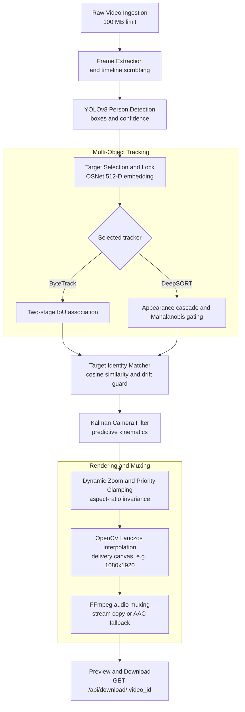

# 🎥 FanCam AI: Autonomous Subject Detection, Tracking & Adaptive Cinematic Reframing

[](https://fastapi.tiangolo.com)
[](https://pytorch.org)
[](https://github.com/ultralytics/ultralytics)
[](https://react.dev)
[](https://vitejs.dev)
[](https://ffmpeg.org)
[](backend/tests)

- **Repository:** https://github.com/emiljinx-core/FanCam-AI
- **Live demo:** served through Cloudflare Tunnel (see [Deployment](#-deployment)); a permanent URL will be added after the named-tunnel setup.

FanCam AI is a computer-vision pipeline that reframes widescreen (`16:9`) footage into vertical (`9:16`), square (`1:1`), or standard (`16:9`) output centred on a person selected by the user. It combines YOLOv8 person detection, OSNet appearance re-identification, ByteTrack/DeepSORT multi-object tracking, a 2D Kalman camera filter, and FFmpeg audio muxing. The project was developed to study stable subject locking and smooth camera motion without manual editing.

---

## 📸 Key Features

- **Interactive target selection:** Choose a person from Frame 0 using real YOLOv8 detections, with bounding-box overlays and confidence values.
- **Identity lock with OSNet Re-ID:** A fixed reference embedding from the selected target, combined with a guarded gallery update, reduces identity drift during occlusion or crossing subjects.
- **Two tracking engines:**
  - **ByteTrack:** IoU-based association of high- and low-confidence detections to preserve tracks through motion blur.
  - **DeepSORT:** Appearance cascade matching with Kalman motion gating and Mahalanobis-distance rejection for crowded scenes.
- **Adaptive framing:**
  - **2D Kalman filter:** Predicts subject position and velocity to reduce camera jitter.
  - **Dynamic zoom:** Adjusts the crop window according to subject occupancy and distance from frame boundaries.
  - **Priority clamping:** Preserves aspect ratio and keeps the crop inside the source frame.
- **Rendering and audio:** Lanczos interpolation to delivery resolution (for example, 1080 × 1920 for 9:16), stream-copy of the source audio with an AAC fallback, and preservation of frame count, FPS, and lip sync.
- **Web interface:** React frontend with asynchronous task polling, source-versus-result comparison, direct download, sample clips, and separate legal pages.
- **Contact form:** Submits through `POST /api/contact`, delivered by Resend. Success is reported only after the API accepts delivery; failures are shown to the user. A honeypot field discards bot submissions.
- **Two distinct demo behaviours:** The **Watch Demo** button opens a YouTube embed modal that accepts only full `https://www.youtube.com/watch?v=...` URLs; clicking a thumbnail opens the separate interactive `DemoModal`.
- **Sample clips hosted externally:** Demo MP4s and thumbnails load from raw GitHub URLs, so no large media files are stored in the repository.

---

## 🏛️ System Architecture



---

## 📂 Repository Structure

```
.
├── backend/
│   ├── app/
│   │   ├── api/
│   │   │   └── routes.py                 # FastAPI routes (health, upload, detect, process, contact)
│   │   ├── core/
│   │   │   ├── framing/
│   │   │   │   ├── camera_filter.py      # 2D Kalman filter for camera motion
│   │   │   │   ├── dynamic_zoom.py       # Occupancy-based crop scaling
│   │   │   │   └── framing_engine.py     # Priority clamping and coordinate quantization
│   │   │   ├── rendering/
│   │   │   │   ├── audio_muxer.py        # FFmpeg stream copy and AAC fallback
│   │   │   │   └── video_renderer.py     # Lanczos frame rendering and comparison canvas
│   │   │   ├── tracking/
│   │   │   │   ├── base_tracker.py       # Detection and track abstractions
│   │   │   │   ├── bytetrack.py          # ByteTrack implementation
│   │   │   │   ├── deepsort.py           # DeepSORT implementation
│   │   │   │   └── target_matcher.py     # OSNet embedding lock and drift guard
│   │   │   ├── detector.py               # YOLOv8 wrapper
│   │   │   ├── mailer.py                 # Resend contact-form delivery
│   │   │   ├── pipeline.py               # End-to-end PipelineOrchestrator
│   │   │   ├── reid.py                   # OSNet feature extractor
│   │   │   ├── tasks.py                  # Task manager
│   │   │   └── video.py                  # Frame extraction and metadata
│   │   ├── models/
│   │   │   └── schemas.py                # Pydantic request/response models
│   │   ├── config.py                     # Settings, CORS, storage paths
│   │   └── main.py                       # App setup, static mounts, /health alias
│   ├── tests/                            # 40 unit and integration tests
│   ├── weights/                          # Included OSNet weight files
│   │   ├── osnet_x0_25_imagenet.pt
│   │   └── osnet_x0_25_msmt17.pt
│   ├── .env.example                      # Template for email and CORS settings
│   └── requirements.txt
├── frontend/
│   ├── src/
│   │   ├── pages/
│   │   │   ├── Home.tsx                  # Landing page and demo modals
│   │   │   ├── Upload.tsx                # Upload and sample-clip selection
│   │   │   ├── SelectTarget.tsx          # Target lock, tracker and aspect ratio
│   │   │   ├── Result.tsx                # Result/comparison player and download
│   │   │   ├── About.tsx                 # Project overview
│   │   │   ├── Contact.tsx               # Resend-backed contact form
│   │   │   ├── PrivacyPolicy.tsx         # Standalone privacy page
│   │   │   ├── TermsOfService.tsx        # Standalone terms page
│   │   │   └── NotFound.tsx
│   │   ├── components/
│   │   │   ├── Header.tsx
│   │   │   ├── Footer.tsx
│   │   │   ├── LegalPage.tsx             # Shared layout for /privacy and /terms
│   │   │   ├── DemoModal.tsx             # Interactive transformation demo
│   │   │   ├── YouTubeDemoModal.tsx      # YouTube embed (full URLs only)
│   │   │   └── BackgroundVideo.tsx
│   │   ├── services/
│   │   │   └── api.ts                    # Typed API client
│   │   └── App.tsx                       # Routes
│   ├── index.html
│   ├── package.json
│   ├── vite.config.ts                    # Dev proxy and tunnel host config
│   └── vercel.json                       # SPA rewrite for Vercel
├── assets/                               # Brand image and sample thumbnails/clips
├── Dockerfile                            # Backend container image
├── .dockerignore
└── README.md
```

---

## 🚀 Quickstart Guide

### Prerequisites

- **Python:** 3.10 to 3.13
- **Node.js:** v18+ with npm
- **FFmpeg:** available on `PATH` or inside an Anaconda environment
- **CUDA/GPU:** optional. CPU execution is supported via `FORCE_CPU=true`; processing is slower on CPU.

### 1. Backend setup

```bash
cd backend

# Create and activate a virtual environment
python -m venv venv
# Windows:
.\venv\Scripts\activate
# Linux/macOS:
source venv/bin/activate

# Install dependencies
pip install -r requirements.txt

# Create the local environment file
# Windows:
copy .env.example .env
# Linux/macOS:
cp .env.example .env
```

Edit `backend/.env` and set the Resend values if you want the contact form to work. The video-processing features do not require them.

```env
RESEND_API_KEY=re_your_key
CONTACT_EMAIL_TO=your-own-email@example.com
CONTACT_EMAIL_FROM=onboarding@resend.dev
```

Start the API:

```bash
uvicorn app.main:app --host 127.0.0.1 --port 8000 --reload
```

The backend runs at `http://127.0.0.1:8000`. Swagger docs are at `/docs`, and `GET /api/health` (also `/health`) reports the service state.

### 2. Frontend setup

```bash
cd frontend
npm install
npm run dev
```

The frontend runs at `http://localhost:5173`. Leave `VITE_API_BASE_URL` unset for local use — the app then calls relative `/api` paths, which Vite proxies to port 8000.

---

## ⚙️ Environment Variables

| Variable | Side | Required | Purpose |
| :--- | :--- | :--- | :--- |
| `RESEND_API_KEY` | Backend | For contact form | API key for Resend email delivery |
| `CONTACT_EMAIL_TO` | Backend | For contact form | Inbox receiving submissions |
| `CONTACT_EMAIL_FROM` | Backend | No | Verified sender; defaults to `onboarding@resend.dev` |
| `CORS_EXTRA_ORIGINS` | Backend | No | Comma-separated production origins allowed to call the API |
| `FORCE_CPU` | Backend | No | Set to `true` on hosts without a GPU |
| `VITE_API_BASE_URL` | Frontend | No | Backend origin; leave empty for local dev and same-origin tunnelling |

Note: on a free Resend account, `onboarding@resend.dev` can only send to the email address that owns the Resend account.

---

## 🧪 Running Tests

The suite covers unit, algorithmic, and integration flows (40 tests):

```bash
# From the backend directory
python -m pytest tests -q

# Or from the repository root
python -m pytest backend/tests -v

# Frontend production build
npm --prefix frontend run build
```

---

## 🔬 Core Pipeline Specifications

| Stage | Technology | Key properties |
| :--- | :--- | :--- |
| **Ingestion** | FastAPI streaming reader | Enforces a 100 MiB limit, checks extensions, MIME type and file header; keeps source uploads private |
| **Detection** | Ultralytics YOLOv8 | Class 0 (`person`) only; normalized coordinates and confidence scores |
| **Feature extraction** | OSNet (`osnet_x0_25`) | 512-dimensional L2-normalized appearance embeddings |
| **Multi-object tracking** | ByteTrack / DeepSORT | Maintains track IDs across frames and short occlusions |
| **Identity lock** | `TargetMatcher` | Fixed Frame 0 reference; cosine similarity threshold of 0.60 with a gallery drift guard |
| **Camera smoothing** | 2D Kalman filter | State vector `[cx, cy, vx, vy]` with a short reacquisition blend |
| **Framing hierarchy** | `CinematicFramingEngine` | Priority: frame containment, aspect-ratio invariance, subject containment; even-integer coordinates |
| **Rendering and muxing** | OpenCV and FFmpeg | Delivery resolution 1080 × 1920 for 9:16; audio stream copy with AAC fallback; FPS and duration preserved |

---

## 📡 API Overview

| Method | Endpoint | Description |
| :--- | :--- | :--- |
| `GET` | `/` | Service metadata and documentation links |
| `GET` | `/api/health` | Health, storage readiness, device and CUDA status |
| `GET` | `/health` | Alias of `/api/health` for external probes |
| `POST` | `/api/upload` | Validates and stores a video (100 MB limit) |
| `GET` | `/api/video/{video_id}/meta` | Width, height, FPS, frame count, duration |
| `POST` | `/api/video/{video_id}/extract-frame` | Extracts and caches a frame preview |
| `POST` | `/api/video/{video_id}/detect-frame` | Detects people in the selected frame |
| `POST` | `/api/video/{video_id}/select-target` | Computes and stores the OSNet reference embedding |
| `POST` | `/api/process` | Queues tracking, framing and rendering as a background task |
| `GET` | `/api/status/{task_id}` | Polls task state, progress and output URLs |
| `GET` | `/api/download/{video_id}` | Downloads the rendered MP4 |
| `POST` | `/api/contact` | Validates and delivers a contact message through Resend |
| `GET` | `/static/outputs/...` | Public rendered outputs |
| `GET` | `/static/previews/...` | Public frame and target previews |

---

## 🎬 Sample Clips

Loaded in the browser from `https://raw.githubusercontent.com/emiljinx-core/FanCam-AI/main/assets`.

| Label | File | Detected people |
| :--- | :--- | :--- |
| Dance Demo | `danceDemo.mp4` / `danceDemo.jpg` | 7 |
| Street Demo | `streetDemo.mp4` / `streetDemo.jpg` | 16 |
| Movie Demo | `movieDemo.mp4` / `movieDemo.jpg` | 1 |

The Street Demo is the smallest clip and is suitable for quick tests.

---

## 🌐 Deployment

### Local development

Follow the quickstart above. The frontend dev server proxies `/api` and `/static` to `127.0.0.1:8000`, so no API environment variable is needed.

### Temporary public link (Cloudflare quick tunnel)

With the backend on port 8000 and Vite on port 5173, run a third process:

```bash
cloudflared tunnel --url http://127.0.0.1:5173
```

Cloudflare prints a random `https://*.trycloudflare.com` URL. The whole application is reachable there because Vite proxies the API routes. `frontend/vite.config.ts` sets `allowedHosts: true` so Vite accepts the tunnel hostname.

Limitations: the URL changes on every restart, the tunnel stops when the command stops, and all three processes must remain running.

### Permanent public link (named Cloudflare Tunnel)

Planned setup:

1. Obtain a domain (for example through GitHub Student Pack) and add it to a free Cloudflare account.
2. Create a tunnel in Cloudflare Zero Trust → Networks → Tunnels.
3. Install the tunnel as a Windows service using the dashboard token, so it starts automatically and runs without a visible terminal.
4. Add a Public Hostname pointing at the domain, with service `HTTP` and URL `127.0.0.1:5173`.
5. Start the backend and Vite automatically at login (for example with a shortcut in the Windows Startup folder).
6. Keep the PC powered on and prevent it from sleeping.

The permanent URL will be recorded here once configured.

### Container configuration

`Dockerfile` and `.dockerignore` build the backend image on port 8000 (or the host-provided `PORT`). `frontend/vercel.json` provides the SPA rewrite needed on Vercel. These files support a paid Render + Vercel deployment; they are not required for the local or tunnelled setup.

---

## ⚠️ Known Limitations

- CPU-only processing is considerably slower than GPU inference.
- Uploaded files, previews and rendered videos are stored locally under `backend/storage/`; they are not automatically deleted, and they are lost if that directory is reset.
- A quick tunnel requires the PC to stay on and awake; a named tunnel gives a stable URL but still requires the local processes to run.
- Free Resend senders are restricted to the account owner's email address unless a domain is verified.
- The application is a research/demo prototype and has not been hardened for multi-user production use.

---

## 📄 License and Legal

This project is developed for educational and research purposes. The user-facing privacy and terms pages are available at `/privacy` and `/terms` in the running application; both are written in plain language and are standalone routes.
