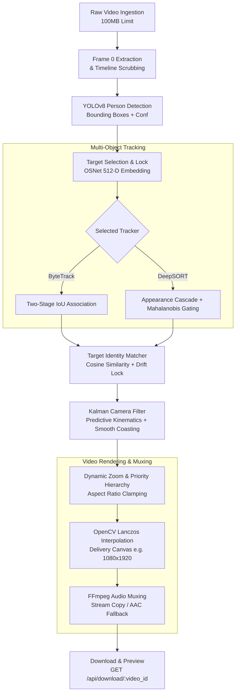

# 🎥 FanCam AI: Autonomous Subject Detection, Tracking & Adaptive Cinematic Reframing

[](https://fastapi.tiangolo.com)
[](https://pytorch.org)
[](https://github.com/ultralytics/ultralytics)
[](https://react.dev)
[](https://vitejs.dev)
[](https://ffmpeg.org)
[]()

**FanCam AI** is a state-of-the-art computer vision and deep learning pipeline that transforms standard widescreen (`16:9`) footage into dynamic, publication-ready vertical (`9:16`), square (`1:1`), or custom reframed videos focused on a selected person. 

By combining **YOLOv8** person detection, **OSNet** deep appearance re-identification (Re-ID), multi-object tracking (**ByteTrack** and **DeepSORT**), predictive **Kalman filter** kinematics, and clean **FFmpeg** audio muxing, FanCam AI produces studio-quality camera pans without jitter, target loss, or audio desynchronization.

---

## 📸 Key Features

* **🎯 Interactive Target Selection:** Select any person directly from Frame 0 of the uploaded video with real YOLOv8 detections, normalized bounding-box overlays, and confidence metrics.
* **🔒 Drift-Proof Identity Lock (OSNet Re-ID):** Immutable reference feature signature paired with a dynamic gallery update safeguard prevents cumulative identity drift and target switching during occlusions or dancer crossings.
* **⚡ Dual Tracking Engine:**
  * **ByteTrack:** High-speed IoU-based tracking associating both high-confidence and low-confidence detections to maintain tracks through motion blur.
  * **DeepSORT:** Appearance cascade matching + Kalman motion gating with Mahalanobis distance rejection for complex spatial crossings.
* **🎥 Adaptive Cinematic Framing:**
  * **2D Kinematic Kalman Filter:** Predicts subject position and velocity vectors, eliminating jittery camera jerks.
  * **Dynamic Zoom:** Automatically tightens or widens the crop window based on subject occupancy and distance from the frame boundary.
  * **Priority Clamping Hierarchy:** Strict aspect-ratio invariance guarantees video never stretches or crops out of frame boundaries.
* **🔊 Audio Sync & High-Quality Rendering:**
  * Slices and scales crops via Lanczos-4 interpolation to native delivery resolutions ($1080 \times 1920$ for 9:16).
  * Lossless audio stream copy (`-c:a copy`) with automatic fallback to high-bitrate AAC (`192 kbps`), preserving exact frame count, source FPS, and lipsync.
* **🖥️ Modern Glassmorphic UI:** High-performance React 19 + Tailwind CSS frontend with live asynchronous task polling, comparison views (Source vs Tracked Crop), and direct download.

---

## 🏛️ System Architecture



---

## 📂 Repository Structure

```
.
├── backend/
│   ├── app/
│   │   ├── api/
│   │   │   └── routes.py             # FastAPI routes (upload, detect, process, status, download)
│   │   ├── core/
│   │   │   ├── framing/              # Cinematic reframing algorithms
│   │   │   │   ├── camera_filter.py  # 2D kinematic Kalman filter for camera panning
│   │   │   │   ├── dynamic_zoom.py   # Occupancy scaling & margin clearance
│   │   │   │   └── framing_engine.py # Priority hierarchy & codec coordinate quantization
│   │   │   ├── rendering/            # Output generation & audio muxing
│   │   │   │   ├── audio_muxer.py    # FFmpeg stream-copy & AAC fallback muxer
│   │   │   │   └── video_renderer.py # Lanczos frame rendering & comparison canvas
│   │   │   ├── tracking/             # Multi-object trackers
│   │   │   │   ├── base_tracker.py   # Standardized Detection & Track abstractions
│   │   │   │   ├── bytetrack.py      # ByteTrack implementation
│   │   │   │   ├── deepsort.py       # DeepSORT appearance association tracker
│   │   │   │   └── target_matcher.py # OSNet embedding lock & drift protection
│   │   │   ├── detector.py           # YOLOv8 person detection wrapper
│   │   │   ├── pipeline.py           # End-to-end PipelineOrchestrator
│   │   │   ├── reid.py               # OSNet deep visual feature extractor
│   │   │   ├── tasks.py              # In-memory & disk-persisted TaskManager
│   │   │   └── video.py              # Frame extraction & metadata inspection
│   │   ├── config.py                 # Application settings & directory management
│   │   └── main.py                   # FastAPI application initialization & static mounts
│   ├── tests/                        # 40 comprehensive unit & integration tests
│   └── requirements.txt              # Backend Python dependencies
├── frontend/
│   ├── src/
│   │   ├── pages/
│   │   │   ├── Home.tsx              # Landing page
│   │   │   ├── Upload.tsx            # Video drag-and-drop ingestion (100MB limit)
│   │   │   ├── SelectTarget.tsx      # Target lock & tracker/aspect-ratio selection
│   │   │   └── Result.tsx            # Highlight/comparison player & download
│   │   ├── services/
│   │   │   └── api.ts                # Typed client API integration
│   │   └── components/               # Glassmorphic UI components
│   ├── package.json
│   └── vite.config.ts                # Vite proxy & build config
└── README.md
```

---

## 🚀 Quickstart Guide

### Prerequisites
* **Python:** 3.10 to 3.13
* **Node.js:** v18+ & npm
* **FFmpeg:** Installed and available on system `PATH` (or in an Anaconda environment)
* **CUDA / GPU:** Recommended for real-time YOLOv8 and OSNet inference (CPU fallback supported automatically)

---

### 1. Backend Setup

```bash
cd backend

# Create and activate virtual environment
python -m venv venv
# On Windows:
.\venv\Scripts\activate
# On Linux/macOS:
source venv/bin/activate

# Install dependencies
pip install -r requirements.txt

# Start backend server
uvicorn app.main:app --host 127.0.0.1 --port 8000 --reload
```
The FastAPI backend will start at `http://127.0.0.1:8000`. Interactive Swagger API docs are available at `http://127.0.0.1:8000/docs`.

---

### 2. Frontend Setup

```bash
cd frontend

# Install npm packages
npm install

# Start Vite development server
npm run dev
```
The frontend will start at `http://localhost:5173`.

---

## 🧪 Running Tests

The test suite covers full unit, algorithmic, and integration flows (40 tests across 12 test modules):

```bash
# Run all backend tests
pytest backend/tests -v

# Run targeted tests
pytest backend/tests/test_framing.py -v       # Kalman filter & dynamic zoom tests
pytest backend/tests/test_rendering.py -v     # Video rendering & FFmpeg muxing tests
pytest backend/tests/test_target_matcher.py -v # OSNet identity lock & drift tests

# Run frontend production build test
npm --prefix frontend run build
```

---

## ⚙️ Core Pipeline Specifications

| Pipeline Stage | Technology | Key Invariants |
| :--- | :--- | :--- |
| **Ingestion** | FastAPI + Streaming Chunk Reader | Enforces strict 100 MiB limit; rejects spoofed MIME types; isolates source files. |
| **Detection** | Ultralytics YOLOv8 | Isolates class 0 (`person`); outputs normalized relative coordinates and confidence scores. |
| **Feature Extraction** | OSNet (`osnet_x0_25`) | Extracts 512-dimensional L2-normalized appearance embeddings per detection crop. |
| **Multi-Object Tracking** | ByteTrack / DeepSORT | Preserves trajectory IDs across frames; handles temporary occlusions up to 30 frames. |
| **Identity Lock** | `TargetMatcher` | Immutable Frame 0 reference vector; cosine similarity threshold $\ge 0.60$; strict gallery drift guard. |
| **Cinematic Smoothing** | 2D Kinematic Kalman Filter | Predicts center velocity; state vector $[c_x, c_y, v_x, v_y]^T$; smooth 5-frame reacquisition blend. |
| **Framing Hierarchy** | `CinematicFramingEngine` | 3-tier priority system: (1) Frame Boundary Containment $\to$ (2) Aspect Ratio Invariance $\to$ (3) Subject Containment. Codec-safe even-integer coordinates. |
| **Rendering & Muxing** | OpenCV + FFmpeg Subprocess | Delivery resolution ($1080 \times 1920$ for 9:16); `-c:a copy` with AAC fallback; exact FPS and frame duration preserved. |

---

## 📡 API Overview

| Method | Endpoint | Description |
| :--- | :--- | :--- |
| `POST` | `/api/upload` | Ingests raw video with strict 100MB constraint verification. |
| `GET` | `/api/video/{video_id}/meta` | Returns video width, height, FPS, frame count, and duration. |
| `POST` | `/api/video/{video_id}/extract-frame` | Extracts and caches a single frame preview as JPEG. |
| `POST` | `/api/video/{video_id}/detect-frame` | Runs YOLOv8 on Frame 0 and returns all detected people with bounding boxes. |
| `POST` | `/api/video/{video_id}/select-target` | Locks target subject and computes initial OSNet reference embedding. |
| `POST` | `/api/process` | Queues background tracking, framing, and rendering task. |
| `GET` | `/api/status/{task_id}` | Polls async task execution progress, stage description, and output URLs. |
| `GET` | `/api/download/{video_id}` | Downloads the completed reframed MP4 with attachment headers. |

---

## 📄 License
This project is developed for educational and research purposes.
